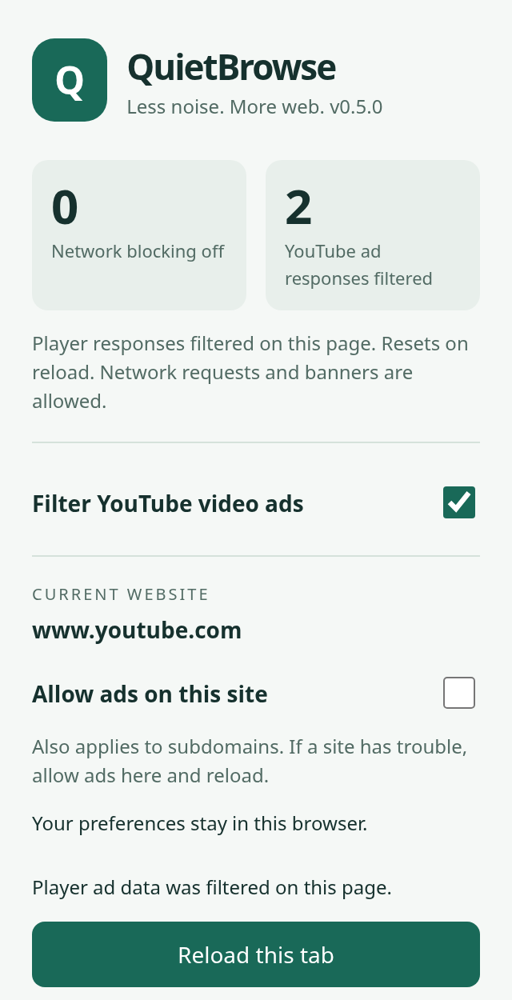

# QuietBrowse

A Chrome extension focused on YouTube player ads. Version **0.5.0** removes general website blocking, network-request blocking, and banner/feed hiding. YouTube detection avoidance is **not verified or guaranteed**.



*Example counts.* The counter measures player responses whose ad data was filtered, not individual commercials. It resets on full page reload; several responses can belong to one ad.

## Install or upgrade

1. [Download the GitHub ZIP](https://github.com/WasayRizwani/Youtube-Ad-Blocker/archive/refs/heads/main.zip) and extract it.
2. Open `chrome://extensions` and enable **Developer mode**.
3. Choose **Load unpacked** and select the folder containing `manifest.json`. For an upgrade, replace your existing extension files and click **Reload** on its card.
4. Confirm version **0.5.0**, then reload all previously open website tabs so scripts from the older version stop running. Keep only one QuietBrowse installation enabled.

No build, account, API key, or npm installation is needed.

## What it does

- Filters supported YouTube player ad metadata before playback, preserving normal video streams, captions, authentication, and playback settings.
- Clicks a visible, enabled Skip button as a fallback. It does not seek, accelerate, mute, or change the video's volume.
- Keeps the reduced polling and parsing work introduced in 0.4.1.
- Leaves network requests alone, including YouTube `/api/stats/ads`, `/pagead/`, and advertising-domain requests. It does not fake successful responses or send fabricated playback reports.
- Does not hide banners, feed ads, or ad containers with CSS. Other websites are outside the extension's page-access scope.

Filtering still operates on known player fields (`adPlacements`, `playerAds`, and `adSlots`). YouTube may group video and companion advertising data in those fields; this is player-focused filtering, not a guarantee that every type of player-associated ad can be separated. Sponsored segments within creator videos are not removed.

The legacy network lists remain packaged but disabled, both by default and at runtime. Startup also clears old dynamic rules and turns off Chrome's request-count badge. The `declarativeNetRequest` permission remains to disable the previous configuration reliably after upgrading. See [third-party attribution](THIRD_PARTY.md) for the inactive EasyList-derived list.

## Controls and counts

- **Filter YouTube video ads** enables or pauses player filtering.
- **Allow ads on this site** pauses QuietBrowse on that YouTube hostname and its subdomains. Reload afterward.
- **YouTube ad responses filtered** counts supported nonempty responses whose ad data was removed. It is not a count of individual ads or proof that an ad was prevented.
- **Network blocking off** stays at zero because this version does not block requests.
- Counts update every two seconds while the popup is open. YouTube navigation without a full page reload retains the current document's total.

Preferences remain in this browser. There is no analytics service or remote backend.

## Compatibility

Stopping request blocking removes one possible detection signal; we have not established that failed requests caused YouTube's warning. Player-data modifications can still be detected. If YouTube blocks playback, allow ads on YouTube and reload; other installed blockers may also trigger the warning.

YouTube can change its response format or deliver advertising within normal streams. Some ads may remain. Player filtering is registered for top-level YouTube documents; embedded players on other sites are outside this scope.

## Development and checks

Node.js 22+, Python 3, and Chromium are needed for tests:

```sh
npm test
npm run test:browser
npm run test:extension
```

Unit tests cover player data, counters, settings, site boundaries, disabled network rules, and performance regressions. Chromium fixtures verify filtering, visible banners, player replacement, Skip controls, counters, and preservation of normal media settings. Fixtures use a synthetic YouTube origin backed by local responses, not the live website.

`test:extension` checks actual unpacked installation, allowed advertising requests, registration, and exceptions. This cloud browser blocks unpacked extension installation by administrator policy, so that check cannot pass here. Live YouTube detection and playback remain unverified. [GitHub Actions](https://github.com/WasayRizwani/Youtube-Ad-Blocker/actions/workflows/test.yml) runs the checks separately.
